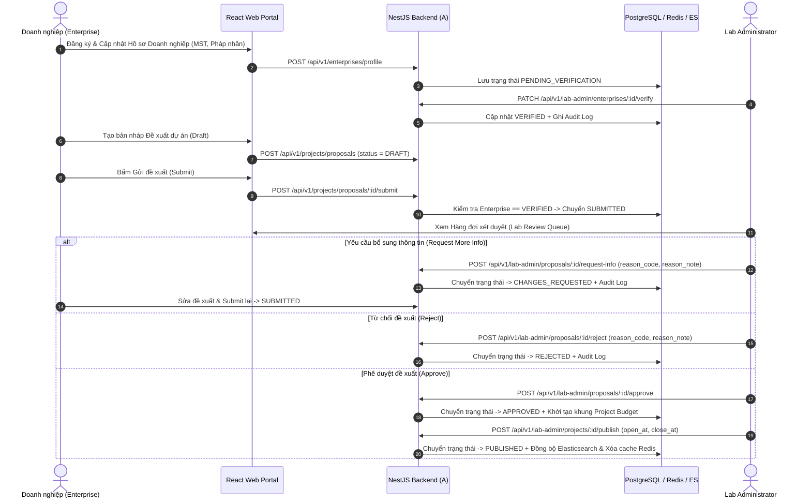
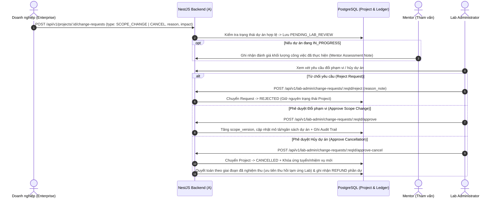
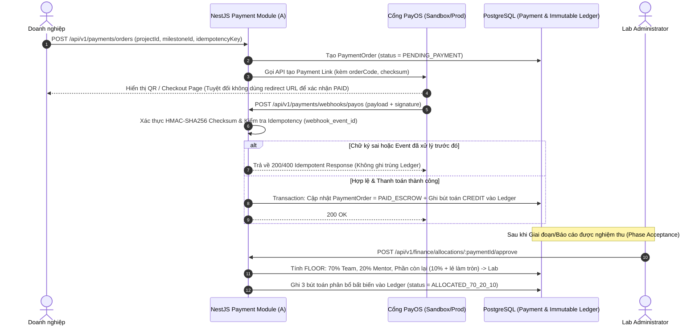
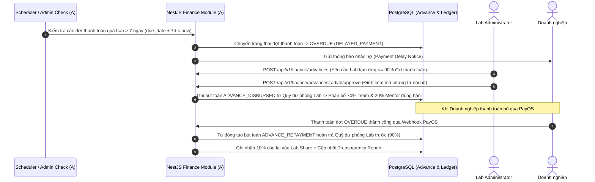
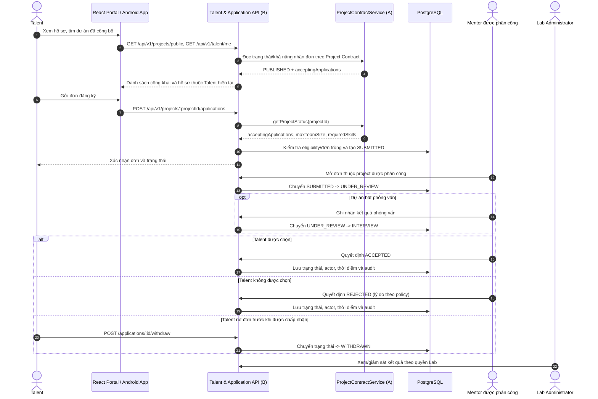
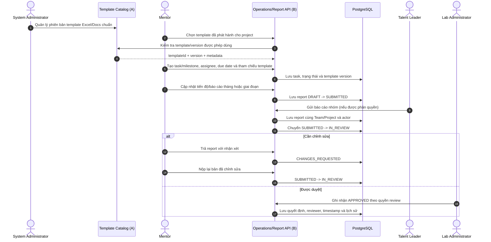

# Ngày D2 — Workshop Luồng Nghiệp vụ, Kiểm tra Hạ tầng & Decision Log (Sinh viên A)

> **Người phụ trách:** Sinh viên A (Owner miền Auth, Enterprise, Lab Admin, System Admin, Project Lifecycle, Finance/PayOS & Hạ tầng)  
> **Giai đoạn:** Giai đoạn 0 — Khởi động và chốt baseline (Ngày D2)  
> **Đầu vào:** Danh sách Requirement IDs và phản hồi câu hỏi PO từ `day1.md`.  
> **Đầu ra:** Sơ đồ chi tiết 4 luồng nghiệp vụ miền A, Nhật ký quyết định (Decision Log) và Biên bản xác nhận quyền truy cập tài khoản/hạ tầng.

---

## 1. Sơ đồ 4 Luồng Nghiệp vụ Cốt lõi của Sinh viên A

### 1.1. Luồng A1: Xác thực Doanh nghiệp & Đề xuất $\rightarrow$ Xét duyệt $\rightarrow$ Công bố Dự án (`REQ-ENT-01`, `REQ-ENT-02`, `REQ-LAB-01`)



---

### 1.2. Luồng A2: Yêu cầu Đổi phạm vi (Scope Change) hoặc Hủy dự án (`REQ-ENT-03`, `REQ-LAB-02`)



---

### 1.3. Luồng A3: Thanh toán PayOS $\rightarrow$ Xác thực Webhook $\rightarrow$ Sổ cái Ledger $\rightarrow$ Phân bổ 70/20/10 (`REQ-FIN-01`, `REQ-FIN-02`, `REQ-FIN-03`)



---

### 1.4. Luồng A4: Chậm thanh toán (Delayed Payment) $\rightarrow$ Lab tạm ứng (Hybrid Fund) $\rightarrow$ Thu hồi nợ tạm ứng (`REQ-FIN-04`, `REQ-FIN-05`)



---

## 2. Nhật ký Quyết định Nghiệp vụ & Kỹ thuật (Decision Log — Chốt Ngày D2)

| Mã QĐ | Ngày chốt | Hạng mục quyết định | Nội dung quyết định chính thức | Người phê duyệt | Ảnh hưởng tới Module của A |
| :--- | :---: | :--- | :--- | :--- | :--- |
| **DEC-01** | D2 | Nguồn lịch chuẩn của dự án | Lấy file `07-phan-cong-tung-ngay.md` làm nguồn chuẩn duy nhất cho tiến độ từng ngày từ D1–D40. | PO & Nhóm A+B | Toàn bộ lộ trình của A |
| **DEC-02** | D2 | Ranh giới Shared Project vs Application | **A** sở hữu toàn bộ bảng `projects`, `project_proposals`, `project_change_requests` và trạng thái vòng đời dự án. **B** sở hữu bảng `applications` và chỉ đọc trạng thái dự án qua contract của A. | Sinh viên A & B | `apps/api/src/projects` |
| **DEC-03** | D2 | Quy tắc xác thực Doanh nghiệp trước khi gửi đề xuất | Doanh nghiệp mới đăng ký (`PENDING_VERIFICATION`) được tạo nháp `DRAFT` nhưng phải được Lab Admin duyệt `VERIFIED` mới được gọi API `submit` đề xuất. | PO / Lab Admin | `REQ-ENT-01`, `REQ-ENT-02` |
| **DEC-04** | D2 | Không tin cậy Client Redirect khi thanh toán | Trạng thái thanh toán `PAID_ESCROW` chỉ được phép cập nhật thông qua **PayOS Webhook đã xác thực chữ ký HMAC-SHA256** hoặc API đối soát server-to-server của Admin. | PO / Finance | `REQ-FIN-01`, `REQ-FIN-02` |
| **DEC-05** | D2 | Quy tắc làm tròn $70/20/10$ trên sổ cái VNĐ | Mọi số tiền lưu kiểu `BIGINT` (đơn vị: VNĐ). Chia $\text{team} = \lfloor \text{net} \times 0.70 \rfloor$, $\text{mentor} = \lfloor \text{net} \times 0.20 \rfloor$, $\text{lab} = \text{net} - \text{team} - \text{mentor}$. Không để thất thoát hoặc lệch $1\text{ VNĐ}$ trên sổ cái. | PO / Finance | `REQ-FIN-03` |
| **DEC-06** | D2 | Cơ chế Quỹ tạm ứng (Hybrid Fund Support) | Xử lý dưới dạng Sổ cái tạm ứng nội bộ (`Advance Ledger`) có phê duyệt của Lab Admin (tối đa $90\%$ đợt trễ hạn $> 7$ ngày) và tự động khấu trừ hoàn quỹ Lab khi doanh nghiệp đóng tiền bù. | PO / Finance | `REQ-FIN-04` |
| **DEC-07** | D2 | Chế độ cổng PayOS khi nghiệm thu D40 | Nghiệm thu đầy đủ trên **PayOS Sandbox**. Trên Production giữ biến môi trường `PAYMENT_MODE=SANDBOX` cho đến khi có biên bản sign-off tài chính riêng. | PO / Finance | `REQ-FIN-01`..`04` |

---

## 3. Biên bản Kiểm tra Quyền truy cập Hạ tầng & Tài khoản Dịch vụ (Cuối Ngày D2)

| STT | Dịch vụ / Tài khoản | Mục đích sử dụng | Trạng thái cuối D2 | Owner quản lý |
| :---: | :--- | :--- | :---: | :---: |
| 1 | **GitHub Repository & Projects** | Quản lý source code Monorepo (`apps/api`, `apps/web`, `apps/mobile`), CI/CD và Kanban Board. | **Đã sẵn sàng (Verified)** | Sinh viên A (Admin) & B |
| 2 | **PayOS Sandbox Account** | Cấp `PAYOS_CLIENT_ID`, `PAYOS_API_KEY`, `PAYOS_CHECKSUM_KEY` để spike và tích hợp D9/D15. | **Đã nhận khóa Sandbox** | Sinh viên A |
| 3 | **Cloudinary Account** | Lưu trữ avatar, tài liệu biểu mẫu Excel/Docs và portfolio. | **Đã nhận khóa API** | A (Hạ tầng) & B (Workflow) |
| 4 | **AWS Staging / Production & Domain** | Triển khai Docker, PostgreSQL, Redis, Elasticsearch và cấu hình HTTPS. | **Đã xác nhận IAM & Subdomain** | Sinh viên A (Server/DB Owner) |
| 5 | **Biểu mẫu Excel/Docs chuẩn của Lab** | Dùng cho cấu hình danh mục mẫu của System Admin (D14) và luồng task/report của B. | **Đã nhận bộ mẫu v1.0** | A (Danh mục) & B (Sử dụng) |

---

## 4. Kết quả Cùng chốt Cuối Ngày D2 (Checkpoint A + B)

- [x] PO xác nhận các luồng nghiệp vụ A và các quyết định B đã ghi trong Decision Log; các chi tiết còn mở (như reviewer cuối cho từng loại report, ngoại lệ tuyển chọn và tiêu chí bầu Leader) được giữ trong danh sách follow-up, không coi là đã chốt.
- [x] Đã kiểm tra thực tế quyền truy cập vào các tài khoản dịch vụ (Git, AWS, PayOS Sandbox, Cloudinary) — không có blocker cấp dự án ở cổng D2.

---

## 5. Sơ đồ Luồng Nghiệp vụ của Sinh viên B

> **Người phụ trách:** Sinh viên B (Owner miền Talent, Mentor, Team/Leader, Task/Template usage, Report/Evaluation và Flutter client).
> **Đầu vào:** Requirement IDs và câu hỏi UX ở [day1.md](./day1.md); DEC-01..DEC-07, Project contract và bộ template v1.0 trong phần A của tài liệu này.
> **Đầu ra:** Luồng ứng tuyển, phân công mentor/nhóm, task/template, báo cáo/đánh giá và phân phối phần quỹ nhóm; các quyết định đã chọn cùng câu hỏi cần bổ sung vào biên bản PO.

### 5.1. Luồng B1: Talent tìm dự án và ứng tuyển (`REQ-TAL-01..03`)



**Quy tắc đã chọn:** Application gồm `SUBMITTED -> UNDER_REVIEW -> (INTERVIEW nếu bật cho dự án) -> ACCEPTED | REJECTED`; Talent được `WITHDRAWN` trước khi được chấp nhận. Mentor được phân công quyết định cuối trong phạm vi project; Lab Admin giám sát và xử lý ngoại lệ. Backend B kiểm tra trạng thái/khung thời gian dự án bằng contract của A, quyền sở hữu và tính duy nhất của đơn.

### 5.2. Luồng B2: Lời mời Mentor, lập nhóm và chọn Talent Leader (`REQ-MEN-01`, `REQ-TEAM-01..03`)

```mermaid
sequenceDiagram
    autonumber
    actor LAB as Lab Administrator
    participant API as Mentor/Team API (B)
    participant DB as PostgreSQL
    actor MEN as Mentor
    actor TAL as Talent được ACCEPTED
    actor LEAD as Talent Leader

    LAB->>API: Tạo/gửi lời mời Mentor cho Project
    API->>DB: Lưu invitation = INVITED + project scope
    MEN->>API: Chấp nhận hoặc từ chối lời mời
    API->>DB: Lưu ACCEPTED/DECLINED và audit
    LAB->>API: Tạo Team từ các application ACCEPTED
    API->>DB: Tạo Team và membership theo giới hạn dự án
    API-->>TAL: Thông báo thành viên/nhóm được phân công
    alt Mentor chỉ định Leader
        MEN->>API: Đề cử một thành viên làm Talent Leader
    else Nhóm bầu Leader
        TAL->>API: Ghi nhận kết quả bầu theo policy của Project
    end
    API->>DB: Kiểm tra ứng viên là member; ghi leader assignment/history
    MEN->>API: Xác nhận Leader theo policy
    API->>DB: Ghi audit và phạm vi quyền Leader
    LEAD->>API: Gửi trao đổi/báo cáo đại diện nhóm
    API->>DB: Gắn hoạt động với Project/Team và actor
```

**Quy tắc đã chọn:** Leader có thể được Mentor chỉ định hoặc do nhóm bầu tùy policy của project; Mentor xác nhận và hệ thống lưu audit. Leader đại diện nhóm trong giao tiếp theo phạm vi được Lab/Mentor cho phép. Chưa giả định quy mô team, cách bầu, quorum hoặc quyền ra quyết định thay mặt nhóm.

### 5.3. Luồng B3: Task/Template và báo cáo (`REQ-OPS-01..02`, `REQ-REP-01`)



**Quy tắc đã chọn:** template Excel/Docs do Lab cung cấp là hồ sơ chuẩn; ứng dụng ghi nhận task/milestone, assignee, trạng thái và file/phiên bản mẫu. Không tích hợp Jira/Trello. Mentor nộp báo cáo tháng/giai đoạn; Leader có thể nộp báo cáo nhóm theo quyền. Trạng thái báo cáo: `DRAFT -> SUBMITTED -> IN_REVIEW -> CHANGES_REQUESTED | APPROVED`.

### 5.4. Luồng B4: Đánh giá, đóng góp và phân phối phần quỹ nhóm (`REQ-REP-02..03`)

```mermaid
sequenceDiagram
    autonumber
    actor MEN as Mentor
    participant API as Evaluation/Redistribution API (B)
    participant FIN as Finance/Ledger API (A)
    participant DB as PostgreSQL
    actor TAL as Talent
    actor LEAD as Talent Leader
    actor LAB as Lab Administrator
    actor ENT as Enterprise

    MEN->>API: Ghi đánh giá/feedback và đóng góp cho member
    API->>DB: Lưu assessment theo Project/Team; trạng thái DRAFT/FINAL
    API-->>TAL: Chỉ hiển thị đánh giá cá nhân đã chốt của Talent đó
    API-->>LAB: Cho phép xem trong phạm vi quản trị/Project
    API-->>ENT: Chỉ cung cấp kết quả nghiệm thu và đánh giá tổng hợp Project
    LEAD->>API: Tạo đề xuất phân phối Team Pool cho thành viên
    API->>FIN: Lấy team-pool và trạng thái khóa qua contract A
    FIN-->>API: totalTeamPoolVnd + allocationStatus + lock status
    API->>DB: Lưu redistribution proposal; không ghi trực tiếp ledger
    MEN->>API: Xác nhận hoặc trả lại proposal theo policy
    API->>DB: Lưu quyết định/audit
    API->>FIN: Chuyển đề xuất đã xác nhận để xử lý theo finance policy
    FIN->>DB: Chỉ finance core/actor được phân quyền mới ghi bút toán
```

**Quy tắc đã chọn:** Talent xem đánh giá đã chốt của mình; Mentor/Lab xem theo project assignment/quyền quản trị; Enterprise xem nghiệm thu và đánh giá tổng hợp của project mình, không xem ghi chú cá nhân nội bộ. Leader quản lý/đề xuất phân phối phần quỹ Team; Mentor xác nhận. B chỉ sở hữu workflow/UX đề xuất; A sở hữu Payment/Ledger và việc ghi bút toán.

---

## 6. Decision Log B — Chốt D2

| Mã QĐ | Hạng mục | Quyết định | Người phê duyệt / trạng thái | Ảnh hưởng |
|---|---|---|---|---|
| **DEC-B01** | State Application | `SUBMITTED -> UNDER_REVIEW -> INTERVIEW` nếu project bật phỏng vấn -> `ACCEPTED/REJECTED`; Talent được rút đơn trước khi ACCEPTED. | PO xác nhận theo lựa chọn của người dùng; không yêu cầu ghi tên/ngày ký trong bộ tài liệu làm việc. | `REQ-TAL-02..03`, `REQ-MEN-02` |
| **DEC-B02** | Người quyết định Application | Mentor được phân công quyết định cuối; Lab Admin giám sát và xử lý ngoại lệ. | PO xác nhận theo lựa chọn của người dùng; định nghĩa ngoại lệ/escalation còn mở. | `REQ-MEN-02`, permission matrix D3 |
| **DEC-B03** | Chọn Talent Leader | Mentor chỉ định hoặc nhóm bầu theo policy dự án; Mentor xác nhận và audit. | PO xác nhận theo lựa chọn của người dùng; cách bầu/quorum còn mở. | `REQ-TEAM-02..03` |
| **DEC-B04** | Task và template | Mẫu Excel/Docs chuẩn của Lab vẫn là hồ sơ chính; app ghi nhận task/milestone/assignee/status và file/version. Không dùng Jira/Trello. | PO xác nhận theo lựa chọn của người dùng; danh mục trường task cụ thể còn theo template v1.0. | `REQ-OPS-01..02` |
| **DEC-B05** | Báo cáo | Mentor gửi báo cáo tháng/giai đoạn; Leader có thể gửi báo cáo nhóm; lifecycle `DRAFT -> SUBMITTED -> IN_REVIEW -> CHANGES_REQUESTED/APPROVED`. | PO xác nhận theo lựa chọn của người dùng; người review cuối theo loại report cần ghi trong approval matrix. | `REQ-REP-01` |
| **DEC-B06** | Quyền xem profile/evaluation | Talent tự xem hồ sơ và đánh giá đã chốt của mình; Mentor theo project được giao; Lab Admin theo quyền quản trị; Enterprise chỉ xem ứng viên của project mình và kết quả nghiệm thu/đánh giá tổng hợp, không xem ghi chú nội bộ. | PO xác nhận theo lựa chọn của người dùng; baseline trường/quyền xem Talent được chốt ở Q-B01, các chi tiết còn lại tiếp tục là follow-up. | `REQ-TAL-01`, `REQ-REP-02`, `REQ-ENT-04` |
| **DEC-B07** | Team fund redistribution | Leader quản lý/đề xuất phân phối Team Pool; Mentor xác nhận; B không tự ghi Ledger hoặc quyết định công thức tiền. | PO/Finance xác nhận quy trình ở mức này; rulebook tài chính A D2 điều khiển việc ghi Ledger. | `REQ-REP-03`, `REQ-FIN-03` |

Các lựa chọn B trên được người dùng xác nhận là PO đã duyệt. Theo chỉ dẫn hiện tại, bộ tài liệu làm việc không cần bổ sung tên/ngày ký; nội dung này không được diễn giải thành chữ ký hoặc biên bản pháp lý. Nền tảng nghiệm thu Flutter Android vẫn là nội dung chờ PO xác nhận theo quyết định D1.

## 7. Kết quả Cùng chốt cuối ngày D2 (A + B)

- [x] Dùng Project lifecycle/status contract của A; B sở hữu Application workflow/schema theo DEC-02.
- [x] A sở hữu Auth/RBAC implementation, Project, Finance/Ledger, System Admin/template catalog và Cloudinary infrastructure; B sở hữu Talent/Mentor/Team/Task/Report và luồng sử dụng template/file.
- [x] Application decision cuối thuộc Mentor được phân công; Lab Admin giám sát/xử lý ngoại lệ. Cần xác định loại ngoại lệ và escalation criteria trong approval matrix D3.
- [x] Team Leader có thể được Mentor chỉ định hoặc nhóm bầu theo policy project; Mentor xác nhận, audit.
- [x] Excel/Docs của Lab là mẫu chuẩn; app theo dõi metadata/task/workflow, không tích hợp Jira/Trello.
- [x] Quyền xem profile, evaluation và report được giới hạn theo self/project/team; Enterprise không xem ghi chú đánh giá nội bộ.
- [x] Các quyết định A trong DEC-01..DEC-07 và trạng thái tài khoản dịch vụ được xác nhận là quyết định/thông tin thực tế; PO đã xác nhận theo người dùng. Không ghi secrets; bộ tài liệu làm việc không yêu cầu metadata tên/ngày PO.
- [x] Ghi nhận các quyết định PO theo xác nhận của người dùng; không yêu cầu thêm metadata tên/ngày trong bộ tài liệu làm việc.
- [ ] Chốt các câu hỏi còn mở: trường profile chia sẻ, eligibility, tiêu chí/quorum bầu Leader, reviewer report, trạng thái task, escalation khi khiếu nại và Android release/distribution.