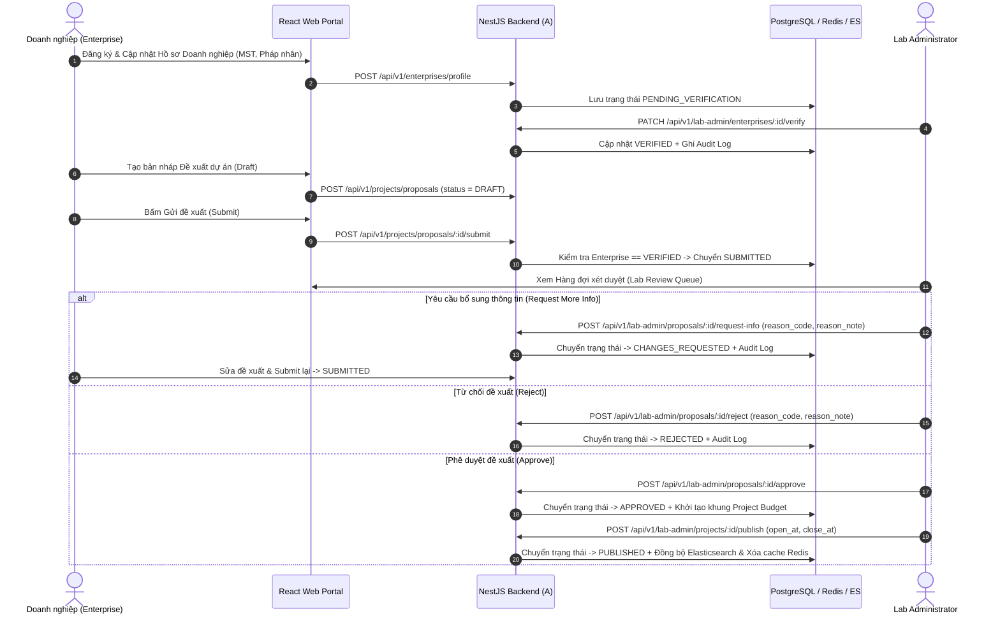
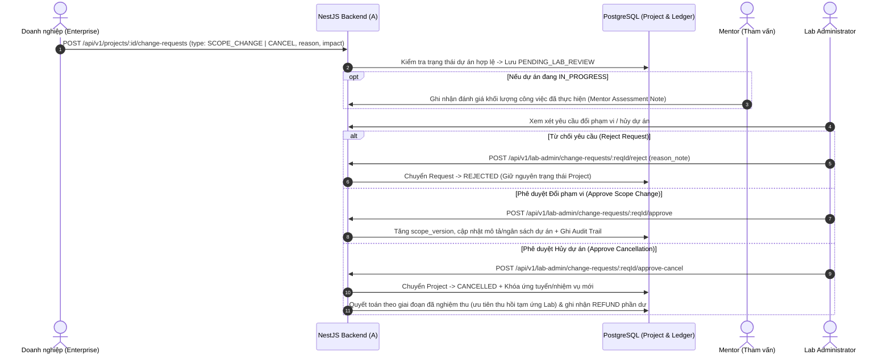
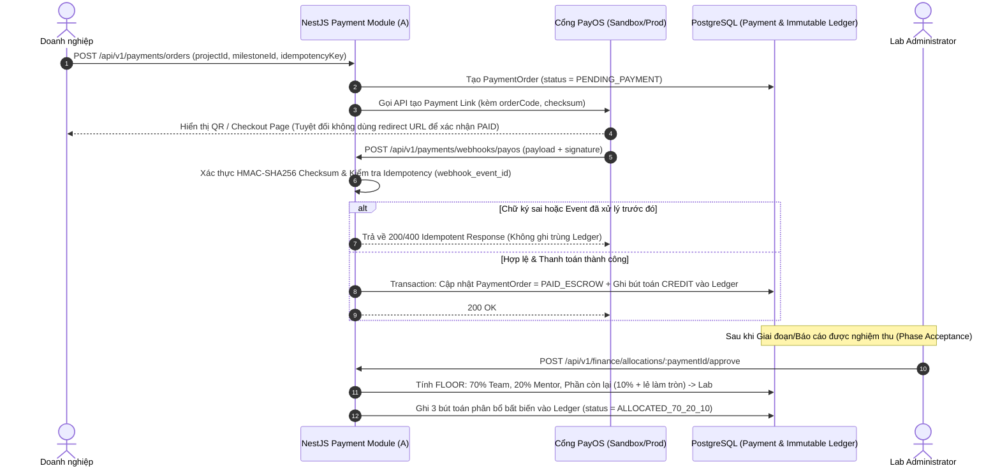
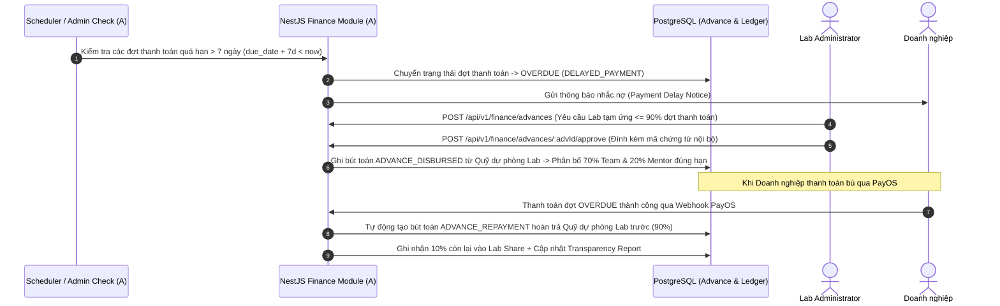

# Ngày D2 — Workshop Luồng Nghiệp vụ, Kiểm tra Hạ tầng & Decision Log (Sinh viên A)

> **Người phụ trách:** Sinh viên A (Owner miền Auth, Enterprise, Lab Admin, System Admin, Project Lifecycle, Finance/PayOS & Hạ tầng)  
> **Giai đoạn:** Giai đoạn 0 — Khởi động và chốt baseline (Ngày D2)  
> **Đầu vào:** Danh sách Requirement IDs và phản hồi câu hỏi PO từ `day1.md`.  
> **Đầu ra:** Sơ đồ chi tiết 4 luồng nghiệp vụ miền A, Nhật ký quyết định (Decision Log) và Biên bản xác nhận quyền truy cập tài khoản/hạ tầng.

---

## 1. Sơ đồ 4 Luồng Nghiệp vụ Cốt lõi của Sinh viên A

### 1.1. Luồng A1: Xác thực Doanh nghiệp & Đề xuất $\rightarrow$ Xét duyệt $\rightarrow$ Công bố Dự án (`REQ-ENT-01`, `REQ-ENT-02`, `REQ-LAB-01`)

---

### 1.2. Luồng A2: Yêu cầu Đổi phạm vi (Scope Change) hoặc Hủy dự án (`REQ-ENT-03`, `REQ-LAB-02`)

---

### 1.3. Luồng A3: Thanh toán PayOS $\rightarrow$ Xác thực Webhook $\rightarrow$ Sổ cái Ledger $\rightarrow$ Phân bổ 70/20/10 (`REQ-FIN-01`, `REQ-FIN-02`, `REQ-FIN-03`)

---

### 1.4. Luồng A4: Chậm thanh toán (Delayed Payment) $\rightarrow$ Lab tạm ứng (Hybrid Fund) $\rightarrow$ Thu hồi nợ tạm ứng (`REQ-FIN-04`, `REQ-FIN-05`)

---

## 2. Nhật ký Quyết định Nghiệp vụ & Kỹ thuật (Decision Log — Chốt Ngày D2)

| Mã QĐ | Ngày chốt | Hạng mục quyết định | Nội dung quyết định chính thức | Người phê duyệt | Ảnh hưởng tới Module của A |
| :--- | :---: | :--- | :--- | :--- | :--- |
| **DEC-01** | D2 | Nguồn lịch chuẩn của dự án | Lấy file `07-phan-cong-tung-ngay.md` làm nguồn chuẩn duy nhất cho tiến độ từng ngày từ D1–D40. | PO & Nhóm A+B | Toàn bộ lộ trình của A |
| **DEC-02** | D2 | Ranh giới Shared Project vs Application | **A** sở hữu toàn bộ bảng `projects`, `project_proposals`, `project_change_requests` và trạng thái vòng đời dự án. **B** sở hữu bảng `applications` và chỉ đọc trạng thái dự án qua contract của A. | Sinh viên A & B | `apps/api/src/projects` |
| **DEC-03** | D2 | Quy tắc xác thực Doanh nghiệp trước khi gửi đề xuất | Doanh nghiệp mới đăng ký (`PENDING_VERIFICATION`) được tạo nháp `DRAFT` nhưng phải được Lab Admin duyệt `VERIFIED` mới được gọi API `submit` đề xuất. | PO / Lab Admin | `REQ-ENT-01`, `REQ-ENT-02` |
| **DEC-04** | D2 | Không tin cậy Client Redirect khi thanh toán | Trạng thái thanh toán `PAID_ESCROW` chỉ được phép cập nhật thông qua **PayOS Webhook đã xác thực chữ ký HMAC-SHA256** hoặc API đối soát server-to-server của Admin. | PO / Finance | `REQ-FIN-01`, `REQ-FIN-02` |
| **DEC-05** | D2 | Quy tắc làm tròn $70/20/10$ trên sổ cái VNĐ | Mọi số tiền lưu kiểu `BIGINT` (đơn vị: VNĐ). Chia $\text{team} = \lfloor \text{net} \times 0.70 \rfloor$, $\text{mentor} = \lfloor \text{net} \times 0.20 \rfloor$, $\text{lab} = \text{net} - \text{team} - \text{mentor}$. Không để thất thoát hoặc lệch $1\text{ VNĐ}$ trên sổ cái. | PO / Finance | `REQ-FIN-03` |
| **DEC-06** | D2 | Cơ chế Quỹ tạm ứng (Hybrid Fund Support) | Xử lý dưới dạng Sổ cái tạm ứng nội bộ (`Advance Ledger`) có phê duyệt của Lab Admin (tối đa $90\%$ đợt trễ hạn $> 7$ ngày) và tự động khấu trừ hoàn quỹ Lab khi doanh nghiệp đóng tiền bù. | PO / Finance | `REQ-FIN-04` |
| **DEC-07** | D2 | Chế độ cổng PayOS khi nghiệm thu D40 | Nghiệm thu đầy đủ trên **PayOS Sandbox**. Trên Production giữ biến môi trường `PAYMENT_MODE=SANDBOX` cho đến khi có biên bản sign-off tài chính riêng. | PO / Finance | `REQ-FIN-01`..`04` |

---

## 3. Biên bản Kiểm tra Quyền truy cập Hạ tầng & Tài khoản Dịch vụ (Cuối Ngày D2)

| STT | Dịch vụ / Tài khoản | Mục đích sử dụng | Trạng thái cuối D2 | Owner quản lý |
| :---: | :--- | :--- | :---: | :---: |
| 1 | **GitHub Repository & Projects** | Quản lý source code Monorepo (`apps/api`, `apps/web`, `apps/mobile`), CI/CD và Kanban Board. | **Đã sẵn sàng (Verified)** | Sinh viên A (Admin) & B |
| 2 | **PayOS Sandbox Account** | Cấp `PAYOS_CLIENT_ID`, `PAYOS_API_KEY`, `PAYOS_CHECKSUM_KEY` để spike và tích hợp D9/D15. | **Đã nhận khóa Sandbox** | Sinh viên A |
| 3 | **Cloudinary Account** | Lưu trữ avatar, tài liệu biểu mẫu Excel/Docs và portfolio. | **Đã nhận khóa API** | A (Hạ tầng) & B (Workflow) |
| 4 | **AWS Staging / Production & Domain** | Triển khai Docker, PostgreSQL, Redis, Elasticsearch và cấu hình HTTPS. | **Đã xác nhận IAM & Subdomain** | Sinh viên A (Server/DB Owner) |
| 5 | **Biểu mẫu Excel/Docs chuẩn của Lab** | Dùng cho cấu hình danh mục mẫu của System Admin (D14) và luồng task/report của B. | **Đã nhận bộ mẫu v1.0** | A (Danh mục) & B (Sử dụng) |

---

## 4. Kết quả Cùng chốt Cuối Ngày D2 (Checkpoint A + B)

- [x] PO đã xác nhận toàn bộ sơ đồ luồng nghiệp vụ của Sinh viên A và Sinh viên B; không còn luồng nào thiếu người phê duyệt.
- [x] Đã kiểm tra thực tế quyền truy cập vào các tài khoản dịch vụ (Git, AWS, PayOS Sandbox, Cloudinary) — không có blocker cấp dự án ở cổng D2.