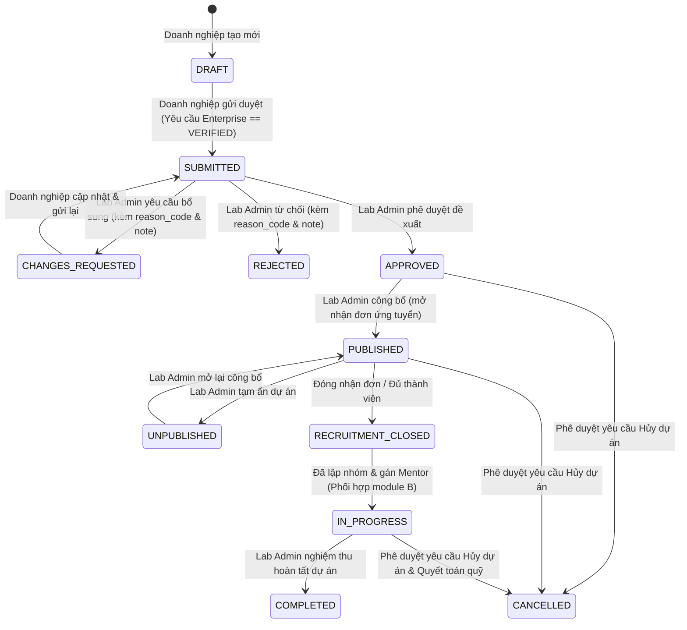
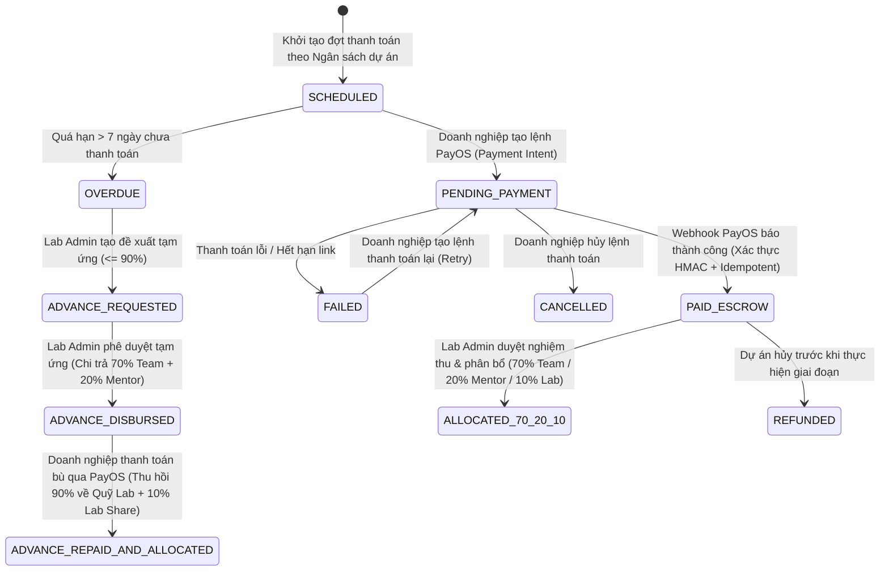

# Ngày D3 — State Machines, Ma trận Phân quyền, Acceptance Criteria & API Contracts (Sinh viên A)

> **Người phụ trách:** Sinh viên A (Owner miền Auth, Enterprise, Lab Admin, System Admin, Project Lifecycle, Finance/PayOS & Hạ tầng)  
> **Giai đoạn:** Giai đoạn 0 — Khởi động và chốt baseline (Ngày D3)  
> **Đầu vào:** Sơ đồ luồng nghiệp vụ và Decision Log từ `day2.md`.  
> **Đầu ra:** State Machines miền A, Ma trận phân quyền RBAC/Ownership server-side, Acceptance Criteria (Given/When/Then), Shared Database/API Contracts và NFR Test Charter.

---

## 1. Máy Trạng Thái (State Machines) Miền Nghiệp vụ của Sinh viên A

### 1.1. State Machine 1: Vòng đời Đề xuất & Dự án (`Project & Proposal Lifecycle`)



**Quy tắc bất biến (State Invariants) kiểm tra tại Backend của A:**
- Doanh nghiệp chỉ được phép `PATCH/PUT` nội dung đề xuất khi trạng thái hiện tại là `DRAFT` hoặc `CHANGES_REQUESTED`.
- Module `Talent/Application` của Sinh viên B chỉ được phép truy vấn danh sách dự án công khai hoặc tạo đơn ứng tuyển khi `project.status === 'PUBLISHED'` và thời gian hiện tại $t$ thỏa mãn $\text{registration\_open\_at} \le t \le \text{registration\_close\_at}$.

---

### 1.2. State Machine 2: Yêu cầu Đổi phạm vi / Hủy dự án (`Change / Cancellation Request`)

| Trạng thái nguồn | Hành động (Action) | Actor được phép | Trạng thái đích | Tác động phụ (Side Effects) |
| :--- | :--- | :--- | :--- | :--- |
| *(Khởi tạo)* | `createChangeRequest` | `ENTERPRISE` (Chủ dự án) | `PENDING_LAB_REVIEW` | Kiểm tra dự án đang `PUBLISHED` hoặc `IN_PROGRESS` (hoặc `APPROVED` nếu xin hủy); lưu vết người tạo. |
| `PENDING_LAB_REVIEW` | `withdrawRequest` | `ENTERPRISE` (Chủ dự án) | `WITHDRAWN` | Đóng yêu cầu khi Lab chưa xử lý. |
| `PENDING_LAB_REVIEW` | `approveRequest` | `LAB_ADMIN` | `APPROVED` | Nếu là `SCOPE_CHANGE`: tăng `scope_version`, cập nhật mô tả/ngân sách. Nếu là `CANCEL`: chuyển `Project.status = CANCELLED` và kích hoạt quy trình quyết toán/hoàn tiền. |
| `PENDING_LAB_REVIEW` | `rejectRequest` | `LAB_ADMIN` | `REJECTED` | Bắt buộc nhập `rejection_reason`; giữ nguyên trạng thái dự án. |

---

### 1.3. State Machine 3: Giao dịch Thanh toán, Sổ cái Phân bổ 70/20/10 & Quỹ Tạm ứng (`Payment, Allocation & Advance`)



---

## 2. Ma trận Phân quyền Server-side (RBAC & Ownership Matrix của Sinh viên A)

| Tài nguyên / Hành động API | `SYSTEM_ADMIN` | `LAB_ADMIN` | `ENTERPRISE` | `MENTOR` | `TALENT_LEADER` | `TALENT` | Quy tắc kiểm tra Ownership ở Backend Guard |
| :--- | :---: | :---: | :---: | :---: | :---: | :---: | :--- |
| Quản lý cấu hình hệ thống, Roles, khóa User, danh mục mẫu Excel | **ALLOW** | DENY | DENY | DENY | DENY | DENY | Chỉ `SYSTEM_ADMIN` |
| Đăng ký / Cập nhật Hồ sơ Doanh nghiệp | DENY | Read/Verify | **ALLOW (Own)** | DENY | DENY | DENY | `enterprise.owner_user_id === currentUser.id` |
| Tạo / Sửa nháp / Gửi Đề xuất dự án (Proposal) | DENY | Read All | **ALLOW (Own)** | DENY | DENY | DENY | `project.enterprise_id === currentUser.enterpriseId` |
| Duyệt / Từ chối / Yêu cầu bổ sung / Công bố / Đóng dự án | DENY | **ALLOW** | Read (Own) | Read (Assigned) | Read (Published) | Read (Published) | Chỉ `LAB_ADMIN` được đổi trạng thái xét duyệt |
| Gửi yêu cầu Đổi phạm vi / Hủy dự án | DENY | Read All | **ALLOW (Own)** | Read (Assigned) | DENY | DENY | `project.enterprise_id === currentUser.enterpriseId` |
| Phê duyệt / Từ chối Đổi phạm vi hoặc Hủy dự án | DENY | **ALLOW** | Read (Own) | Comment (Assigned) | DENY | DENY | Chỉ `LAB_ADMIN` |
| Tạo lệnh thanh toán PayOS & Xem lịch sử đóng tiền dự án | DENY | Read All | **ALLOW (Own)** | DENY | DENY | DENY | `project.enterprise_id === currentUser.enterpriseId` |
| Duyệt phân bổ $70/20/10$, Duyệt Tạm ứng & Đối soát Sổ cái | DENY | **ALLOW** | Read (Own) | Read (Own Share) | Read (Team Share) | Read (Own Share) | Chỉ `LAB_ADMIN` được thực thi bút toán phân bổ/tạm ứng |
| Xem Báo cáo minh bạch tài chính (Tổng hợp / Chi tiết dự án) | Read Summary | **ALLOW (All)** | Read (Own Proj) | Read (Assigned) | Read (Assigned) | Read (Assigned) | Tầng chi tiết kiểm tra membership thuộc `project_id` |

---

## 3. Tiêu chí Nghiệm thu (Acceptance Criteria — Given/When/Then) cho các Story của A

1. **`REQ-AUTH-01` (Xác thực JWT & Phân quyền RBAC):**
   - *Given* người dùng có vai trò `TALENT` hoặc `ENTERPRISE` A, *When* gọi trực tiếp API `POST /api/v1/lab-admin/proposals/:id/approve` hoặc truy cập hồ sơ của `ENTERPRISE` B, *Then* Backend trả về `403 Forbidden` (kèm mã lỗi chuẩn), tuyệt đối không lộ dữ liệu và ghi nhận sự kiện vào bảng `audit_logs`.
2. **`REQ-ENT-01` & `REQ-ENT-02` (Hồ sơ Doanh nghiệp & Đề xuất dự án):**
   - *Given* doanh nghiệp mới đăng ký (`PENDING_VERIFICATION`), *When* tạo bản nháp đề xuất thì thành công (`201 Created`), nhưng *When* bấm gửi duyệt (`submit`) khi chưa được Lab xác thực hồ sơ, *Then* Backend từ chối với lỗi `400 Bad Request (ENTERPRISE_NOT_VERIFIED)`.
   - *Given* đề xuất đã ở trạng thái `SUBMITTED` hoặc `APPROVED`, *When* doanh nghiệp gọi API chỉnh sửa nội dung đề xuất, *Then* Backend từ chối `409 Conflict (INVALID_STATE_TRANSITION)`.
3. **`REQ-LAB-01` (Duyệt & Công bố dự án):**
   - *Given* đề xuất đang ở `SUBMITTED`, *When* Lab Admin chọn `REJECT` hoặc `REQUEST_INFO` mà không gửi kèm `reason_code` và `reason_note` có độ dài $\ge 15$ ký tự, *Then* Backend trả về `422 Unprocessable Entity`.
   - *Given* dự án được Lab Admin chuyển sang `PUBLISHED`, *When* hoàn tất transaction, *Then* bản ghi `audit_logs` phải lưu rõ `actor_id`, `old_state`, `new_state`, `timestamp`, đồng thời chỉ mục Elasticsearch được cập nhật và cache Redis của danh sách dự án được xóa.
4. **`REQ-FIN-01` & `REQ-FIN-02` (Thanh toán PayOS & Webhook Idempotency):**
   - *Given* người dùng giả lập gọi URL redirect `GET /payment/success?orderCode=123` trên trình duyệt, *When* chưa có Webhook hợp lệ từ PayOS, *Then* trạng thái đơn hàng vẫn giữ nguyên `PENDING_PAYMENT`.
   - *Given* PayOS gửi cùng một Webhook sự kiện thanh toán thành công 3 lần liên tiếp (retry/replay), *When* Backend xử lý, *Then* chữ ký HMAC được kiểm tra, chỉ tạo **duy nhất 1 bút toán CREDIT** trong bảng `ledger_entries`, và các lần gọi lặp lại trả về `200 OK` an toàn (idempotent).
5. **`REQ-FIN-03` & `REQ-FIN-04` (Chia quỹ 70/20/10 & Quỹ tạm ứng):**
   - *Given* khoản thanh toán $10,000,001\text{ VNĐ}$ được duyệt phân bổ, *When* chạy hàm tính $70/20/10$, *Then* $\text{team\_share} = 7,000,000\text{ VNĐ}$, $\text{mentor\_share} = 2,000,000\text{ VNĐ}$, $\text{lab\_share} = 1,000,001\text{ VNĐ}$ (tổng đúng bằng $10,000,001\text{ VNĐ}$).
   - *Given* dự án đã được Lab tạm ứng $9,000,000\text{ VNĐ}$ (trên đợt thanh toán $10,000,000\text{ VNĐ}$ bị trễ), *When* doanh nghiệp thanh toán bù $10,000,000\text{ VNĐ}$, *Then* hệ thống tự động ghi bút toán thu hồi $9,000,000\text{ VNĐ}$ hoàn trả Quỹ tạm ứng của Lab và cộng $1,000,000\text{ VNĐ}$ vào phần $10\%$ của Lab (không chi trùng lần 2 cho Team/Mentor).

---

## 4. Đặc tả Cơ sở dữ liệu & Shared API Contract (Chốt giữa A và B)

### 4.1. Các bảng Database thuộc quyền sở hữu Migration của Sinh viên A
- **Shared Auth & System (`001_auth_system`):** `users`, `roles`, `user_roles`, `refresh_tokens`, `system_settings`, `excel_templates_catalog`, `audit_logs`.
- **Enterprise & Project Lifecycle (`002_enterprise_projects`):** `enterprises`, `projects` *(gồm cả thông tin proposal và trạng thái vòng đời dự án)*, `project_change_requests`, `project_state_history`.
- **Finance & Ledger (`003_finance_payments`):** `project_budgets`, `payment_milestones`, `payment_orders`, `payment_webhook_events`, `ledger_entries` *(append-only, bất biến)*, `fund_allocations`, `advance_requests`.

### 4.2. Hợp đồng API (Shared Contract) Sinh viên A cung cấp cho Sinh viên B tiêu thụ
1. **Auth Context Payload (trích xuất từ JWT Guard của A):**
   ```json
   {
     "sub": "uuid-user-id",
     "email": "user@uth.edu.vn",
     "roles": ["TALENT", "TALENT_LEADER"],
     "enterpriseId": null
   }
   ```
2. **Project Summary & Visibility Contract (`GET /api/v1/projects/public` & Internal Service Method `ProjectContractService.getProjectStatus(projectId)`):**
   ```json
   {
     "id": "uuid-project-id",
     "code": "PRJ-2026-001",
     "title": "Hệ thống quản lý kho thông minh",
     "status": "PUBLISHED",
     "acceptingApplications": true,
     "registrationOpenAt": "2026-11-01T00:00:00Z",
     "registrationCloseAt": "2026-11-15T23:59:59Z",
     "maxTeamSize": 5,
     "requiredSkills": ["NestJS", "React", "PostgreSQL"],
     "enterprise": {
       "id": "uuid-ent-id",
       "name": "Công ty TNHH Công nghệ ABC",
       "isVerified": true
     }
   }
   ```
3. **Team Fund Pool Contract (`GET /api/v1/finance/projects/:projectId/team-pool` — dùng cho luồng Leader chia quỹ ở D26 của B):**
   ```json
   {
     "projectId": "uuid-project-id",
     "milestoneId": "uuid-milestone-id",
     "totalTeamPoolVnd": 7000000,
     "allocationStatus": "ALLOCATED",
     "isLockedForRedistribution": false
   }
   ```

---

## 5. Điều lệ Kiểm thử Phi chức năng (NFR Test Charter — Phần của A)

| Mã NFR | Chỉ số mục tiêu | Công cụ & Kịch bản đo (Ngày D34) | Điều kiện Pass nghiệm thu |
| :--- | :--- | :--- | :--- |
| **REQ-NFR-01a** | Tải danh sách dự án $< 5\text{s}$ | Dùng `k6` bắn tải vào `GET /api/v1/projects/public?page=1&limit=20&keyword=...` trên tập dữ liệu seed $1,000$ dự án với $200\text{ VUs}$. | Độ trễ phân vị **$P_{95} < 5,000\text{ ms}$** (mục tiêu nội bộ qua Redis/Elasticsearch: $P_{95} < 500\text{ ms}$), tỷ lệ lỗi $< 0.1\%$. |
| **REQ-NFR-01b** | Xử lý thanh toán $< 3\text{s}$ | Dùng `k6` đo thời gian xử lý API tạo lệnh `POST /api/v1/payments/orders` và API xử lý Webhook `POST /api/v1/payments/webhooks/payos`. | Thời gian xử lý nội bộ tại Backend + DB Transaction đạt **$P_{95} < 3,000\text{ ms}$**, đảm bảo $0\%$ lỗi race condition / duplicate ledger. |
| **REQ-NFR-02** | $99.0\%$ Uptime & $200\text{--}300\text{ VUs}$ | Chạy bài test chịu tải hỗn hợp $200\text{--}300\text{ VUs}$ trong 10 phút liên tục; theo dõi `/api/v1/health` (check DB, Redis, ES). | Không sập container, CPU/Memory ổn định, Uptime trong cửa sổ đo đạt $\ge 99.0\%$. |
| **REQ-NFR-03** | Bảo mật & Phân quyền Server-side | Bộ Integration Tests tự động bằng Jest/Supertest kiểm tra toàn bộ ma trận quyền ở Mục 2 và kiểm tra log redaction. | **$100\%$ Negative Auth Tests Pass**; không lộ token, mật khẩu hay `PAYOS_CHECKSUM_KEY` trong log/response. |

---

## 6. Kết quả Cùng chốt Cuối Ngày D3 (Checkpoint A + B)

- [x] Đã chốt Auth/Role JWT contract và Project/Application shared contract giữa Sinh viên A và Sinh viên B.
- [x] Đã thống nhất quy tắc Migration: mỗi người tạo file migration có prefix riêng (`001_a_...`, `002_b_...`), không sửa trực tiếp vào file migration của người kia.